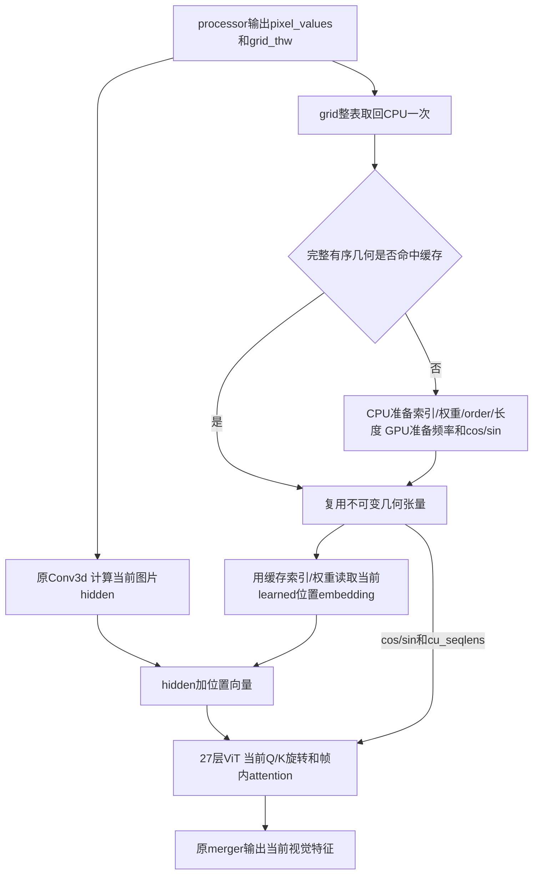

# prepared metadata：视觉输入从网格到27层ViT的完整流程

2026-11-11。当前训练使用原Conv3d、flash视觉RoPE、prepared metadata；Linear已撤回。本文件说明实际实现，不把Graph与metadata混为同一优化。Graph结果另见本轮Graph记录及handoff。

## 1. metadata到底是什么

processor把图片/视频变成两类输入：

- `pixel_values`：实际像素patch内容。当前每patch展开为1536个数，即3通道×2个时间采样×16×16；通过Conv3d得到1152维视觉hidden。
- `grid_thw`：每个视觉输入的时序、patch行、patch列网格。它描述布局，不是图片内容。T是processor输出的时序网格长度，不必等于视频原始帧数。

本项目的prepared metadata是由grid推导出来的一组“布局与位置说明”：位置插值该查哪几个点、权重多少、如何按2×2 spatial merge顺序排列、每个时序单元的token边界、RoPE的空间角度和cos/sin等。**不缓存图片像素、Q/K、ViT输出或训练样本内容。**

它也不是语言样本packing；语言packing关闭时，视觉attention仍需通过PackedSeqParams隔离拼在一起的多图/多帧。

## 2. 用一个小例子看懂形状

```python
grid_thw = [[1, 4, 6], [2, 2, 4]]
```

含义：第一项有1个时序单元，每个4×6=24个patch；第二项有2个时序单元，每个2×4=8个patch。

| 推导值 | 结果 | 用途 |
| --- | --- | --- |
| 总patch数 | 24+8+8=40 | 检查pixel_values与网格是否对应 |
| 每时序单元长度 | `[24,8,8]` | 每个单元分别做视觉attention |
| `cu_seqlens` | `[0,24,32,40]` | 标记40个token里的三个attention区间 |
| `max_seqlen` | Python整数24 | 最大单区间长度，不是总长40 |
| merge后每输入token数 | `[6,4]` | spatial merge=2，每4个patch合成一个输出 |
| merger后总token数 | 10 | 送给语言侧的视觉特征，宽度5120 |

例如第二个区间只能在token24～31内attention，不能看到第一张图或下一个时序单元；prepared必须保留这一语义。

## 3. 两种位置机制，不要混淆

模型同时使用两种位置机制，prepared没有新增它们：

### 3.1 加在hidden上的learned绝对位置embedding

模型有2304个可学习位置向量，可看作48×48的位置表。实际图片可能是4×6、26×34等patch网格，需要双线性插值。

每个实际patch位置由原表的四个邻居组成：

```text
位置向量 = E[index00]*weight00 + E[index01]*weight01
         + E[index10]*weight10 + E[index11]*weight11
```

`index`、`weight`只由网格和表尺寸决定；`E`是模型当前可学习参数。

prepared可以缓存index/weight，**每次forward仍从当前E取值并做相同乘加**。因此更新或加载E后不会错误地继续使用旧位置向量；训练时梯度仍能回到E。

### 3.2 用于每层Q/K旋转的视觉2D RoPE

RoPE使用patch的实际H/W坐标，和前面把位置映射到48×48表做插值不是同一套数值。当前head_dim72，全维旋转，compact cos/sin各为 `[T,36]` FP32，保持H/W频率与half-split配对。

同一网格下，每层token位置不变，cos/sin可以复用；Q/K取决于图片和层权重，每层仍正常计算和旋转，不能缓存它们。

之前的flash RoPE优化已经做到“每microbatch生成一次cos/sin，27层复用”。prepared在此基础上还允许**几何相同的不同microbatch复用只与几何有关的表**，同时减少CPU/GPU来回提取尺寸和packed参数构造。

## 4. 为什么还需要token顺序order

spatial merge=2要求每个2×2 patch组相邻排列。假设4×6网格按普通行优先编号，位置的merge顺序开头为：

```text
[0,1,6,7, 2,3,8,9, 4,5,10,11, ...]
```

processor的patch内容已经按模型要求排列；**metadata不会再乱序改动pixel_values**。它用order把从普通H/W坐标算出来的位置向量和RoPE坐标对齐到真实patch顺序；多时序单元按原规则重复空间位置。

忽略这个order会出现“同shape却位置对错token”的错误；因此只验证shape是不够的。

## 5. 优化前的完整路径

这里的“原路径”是已经启用flash RoPE、但metadata为reference的版本：

1. pixel_values通过原Conv3d，得到 `[T,1152]`。
2. `fast_pos_embed_interpolate(grid_thw)` 逐图计算插值索引和权重，读取当前位置参数，repeat/permute到真实token顺序。
3. 将位置向量加到hidden。
4. `rot_pos_emb(grid_thw)` 获取最大H/W、总token数，逐图生成merge后的H/W坐标，查频率表并构造角度。
5. `build_packed_seq_params(grid_thw)` 用GPU repeat_interleave/cumsum/pad/max生成帧边界和最大长度。
6. 根据角度生成本microbatch的cos/sin，传给27层；每层Q/K仍正常旋转与attention。
7. merger输出；原代码末端还有按grid算split尺寸、split后立即cat。

问题是grid在GPU上，但Python的linspace长度、arange、view、repeat、if等需要主机整数。逐次使用GPU标量会产生显式 `.item()` 或隐式标量提取，CPU必须等待GPU把值取回。动态repeat_interleave也要推断输出长度，GPU maxlen进入后续backend选择还会触发额外标量判断。

这些数据量很小，主要成本是**反复同步、CPU循环和小操作调度**，不是传输带宽。旧代码已经有不少CPU计算，并不是把一整块GPU数学统一“搬到CPU”这么简单。

## 6. prepared的实际路径



实际调用入口是 `vision_model.py` 的prepared分支：

1. `metadata_cache.get()` 将整张grid一次 `.detach().cpu().tolist()`，得到Python整数元组。当前仍有这一次GPU→CPU同步，而且放在patch提交前，避免后面反复打断GPU队列。
2. 根据key查缓存。命中直接返回；不命中才构造几何。key包含完整有序grids、merge size、位置表边长、device、dtype、rotary dim和theta。
3. pixel_values仍走原Conv3d，计算当前图片hidden。
4. `PreparedVisionMetadata.interpolate(self.pos_embed)` 在GPU读取当前模型位置参数，保持原乘加顺序和dtype，再按order取出每token位置向量；加到hidden后进入原decoder。
5. 用同一GPU int32 cu_seqlens和CPU Python int maxlen构造PackedSeqParams，跨层复用，保持每帧边界。
6. flash路径使用缓存FP32 cos/sin；reference RoPE路径仍能按原dtype构造重复角度，便于对照。
7. prepared路径末端省去没有语义作用的split后立即cat；实际输出顺序保持。

metadata主要字段：

| 字段 | 保存什么 | 每次forward是否重算 |
| --- | --- | --- |
| indices / weights | 位置表四邻居索引和插值权重 | 同几何命中不重算 |
| order | 重排/重复位置到实际token顺序 | 同几何命中不重算 |
| rotary_half、cos、sin | 实际空间位置角度及FP32三角表 | 命中不重算 |
| cu_seqlens | 每帧attention边界，GPU int32 | 命中复用 |
| max_seqlen / total_tokens / split_sizes | Python整数长度信息 | 命中复用 |
| learned位置向量 | **没有缓存最终值** | 每次读取当前参数并计算 |
| pixel/Q/K/视觉特征 | **没有缓存** | 每次正常计算 |

默认最多16条、64MiB几何张量payload，LRU逐出旧项；这不是全进程reserved显存上限。不同图片内容可复用同几何；不同有序几何不能只因总token数相同而误命中。模型设备/精度变换会清缓存；手工改变频率buffer等不经过模型转换接口的操作应主动clear。

## 7. 为什么预期不改变精度，以及实际证明

原因是这些几何量由整数网格确定；保持原坐标、插值公式、dtype转换位置、加法顺序与attention边界，只改变准备时机和复用方式。几何构造在no_grad里，learned位置查表仍在正常autograd路径中。

不是仅凭原理认定无误，实际已经做了：

- 索引/位置值、角度、cos/sin、cu_seqlens的原路径逐项比较；多图、非方图、多时序单元、同总长不同边界、缓存命中/驱逐、位置权重更新均覆盖。
- 回退后的metadata/RoPE定向回归94 passed、2 skipped；本轮加入Graph检查后的总定向回归101 passed、2 skipped。
- 原Conv3d、完整27层、TP2、BF16固定权重审计：真实1844-token双图的逐层及最终输出、多帧40-token的输入及已计算参数梯度，16项精确判定全部true，max abs和relative L2均为0；本轮扩展到Graph的审计共24项，也全部逐位一致。

因此在当前所测配置与样例中，prepared与reference **逐位一致**。它与之前Linear的“数学等价但BF16舍入改变”不同：Linear已撤回，metadata保留原计算及bias路径。

该结论不是对所有平台、任意输入和未测模式的形式化保证，也不是长期任务accuracy评测；但它比“loss看起来接近”更直接地验证了当前改动。

## 8. 性能变化该怎样理解

独立准备函数的三种网格：reference中位2.74～3.25ms，prepared缓存命中0.151～0.189ms，冷缓存0.785～0.831ms。收益来自少同步、少构造、复用，不是减少图片token或改变attention。

训练profile中：首个视觉LayerNormLinear前的scalar调用33→1，整步11659→2699；视觉varlen仍1728次、rotary仍3456次、Conv3d im2col仍108916次。剩余scalar来自其他路径，不能宣称全模型没有同步。

C0/C1整步测试有外部干扰，不能把均值差23.71%归因于metadata；而且PP4最后语言stage工作更重。局部准备变快不一定等比例加速完整step。

实现：Bridge `modelling_qwen3_vl/vision_metadata.py`、`vision_model.py`；入口配置 `VISION_METADATA_BACKEND=prepared|reference`。详细工件见 [Conv3d+metadata验收](qwen38-metadata-conv-20261111.md)，最新Graph测试进度见handoff。
